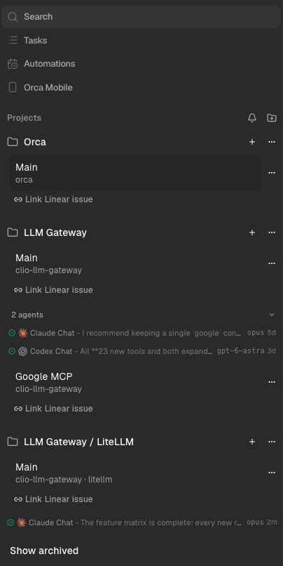

- [ ] need cleanup. put link linear issue under ..., it should be accessed cmd pallet anyways
- [ ] visually need more distinction between areas, it's hard to read
- [ ] shortcut to switch between workspaces. possibly more than one option. for example the thing neovim does, bookmarks or hooks or something like that
- [ ] it's hard to tell what is most recent, we need some sort of ways to help stay automatically organized.
- [ ] maybe we need more colour coding for current task, like a review vs a feature vs planning
- [ ] be able to archive a workspace while it's still open, it' a pain to switch then archive
- [ ] the project roots dont show up well, we need some way to display that better, unclear what that would be without looking ugly
- [ ] a way to drag and drop (move) workspaces across projects that have the same project root(s)

