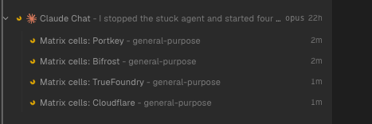
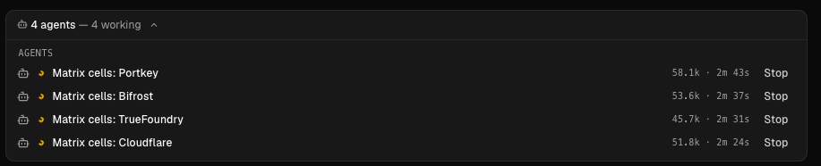
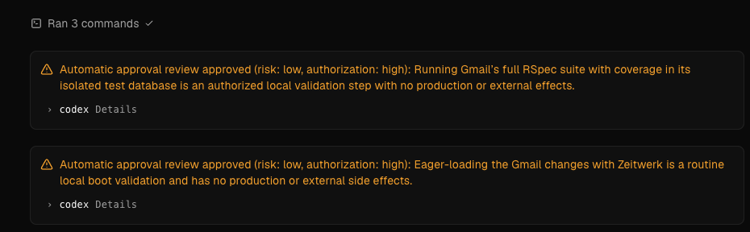
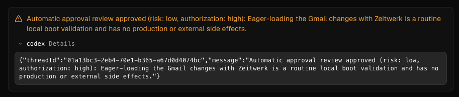
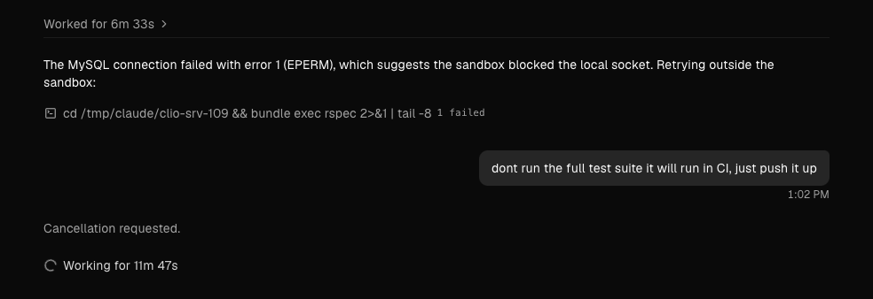
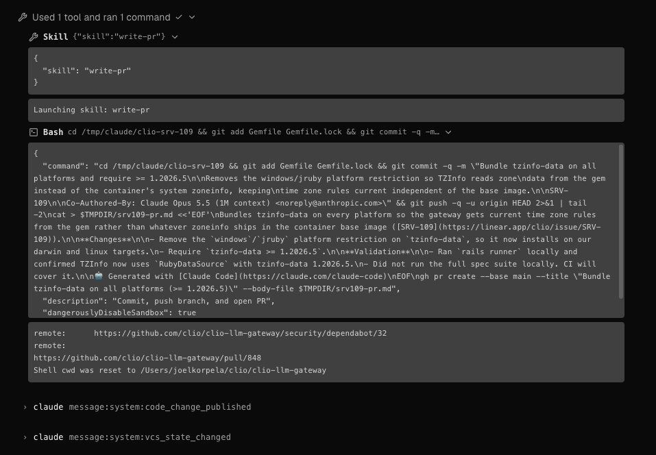

- [ ] cmd+f search seems to be missing
- [ ] linear integration is not fully working. attaching a ticket to a workspace does not automatically mean the agent can see that
- [ ] visualizations (image generation, html, mermaid, etc)
- [ ] permissions (auto approve? something between manual and yolo)
- [ ] how is sub agent usage handled currently? might be too liberal where it does it automatically without being asked. For example, I asked it to double check a list and it spun up 9 sub agents (both good and bad)
- [ ] sub agent visuals, I cant click on these in the left side how do I see what a sub agent is doing  

  
or in agent chat these cant be clicked  

- [ ] tool and tool approval rendering is really bad. it's the opposite of what we need, the approval is huge and the tool call and result is hidden and poorly displayed. just an approval icon (with a hover) would work, and we can make a much more first class tool call/result display  

  

- [ ] no way to go back messages like Claude and Codex can

- [ ] what the heck is it working on!?  

- [ ] more poor tool use UI  

- [ ] there appears to be a bug where if a cancel a request an agent can be stuck where the editor and agent chat shows "working" but the agent (correctly) isn't doing anything
- [ ] there is no indication of sub agent model/effort level

